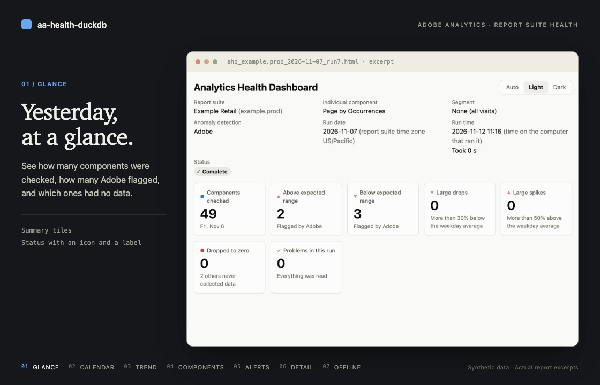

# aa-health-duckdb

[](https://github.com/brian-a-au/aa-health-duckdb/actions/workflows/tests.yml)
[](https://github.com/brian-a-au/aa-health-duckdb/actions/workflows/lint.yml)
[](https://pypi.org/project/aa-health-duckdb/)
[](https://www.python.org/downloads/)
[](https://github.com/brian-a-au/aa-health-duckdb/tree/main/tests)
[](https://github.com/astral-sh/ruff)
[](https://github.com/astral-sh/uv)
[](https://duckdb.org/)
[](https://github.com/brian-a-au/aa-health-duckdb/blob/main/LICENSE)

[](https://github.com/brian-a-au/aa-health-duckdb/blob/main/docs/showcase.png)

32-second loop of real report excerpts, made from synthetic data. Click the animation for a still image.

aa-health-duckdb checks the health of an Adobe Analytics report suite. For every custom event, eVar and prop, it shows yesterday's value, its weekday average, and whether Adobe's anomaly detection flagged it. The weekday average is the average of the same weekday in the 12 weeks before, e.g., the 12 Mondays before a Monday. It also finds large drops and large spikes against the weekday average. It finds values that dropped to zero, and it lists components that never collected data apart.

It is an unofficial alternative to Adobe's Excel workbook ["Analytics Health Dashboard"](https://new.express.adobe.com/webpage/y6DGOeWmpo7Uh), built on the [Adobe Analytics 2.0 API](https://developer.adobe.com/analytics-apis/docs/2.0/). The command is `ahd`.

## What it does

- **One report you can open anywhere.** Each run writes one HTML file that works in any browser, offline. It has three tabs: Components Summary, Individual Component Summary and Alerts Summary. [The report](https://github.com/brian-a-au/aa-health-duckdb/blob/main/docs/report.md) walks through it.
- **Alerts that matter.** It lists Adobe's anomaly flags, drops and spikes larger than percents you set with two sliders, and components that dropped to zero. Components that never collected data are listed apart, so they don't hide real problems. In place of Adobe's flags, it can use one of three simpler methods that it computes from the run's own data. You choose one with `--anomaly-method`. See [Anomaly detection methods](https://github.com/brian-a-au/aa-health-duckdb/blob/main/docs/report.md#anomaly-detection-methods).
- **Every run kept.** It stores each run in a local DuckDB file, so you can compare runs, report suites and organizations with SQL, and send alert emails only when something is new. See the [DuckDB guide](https://github.com/brian-a-au/aa-health-duckdb/blob/main/docs/duckdb.md).
- **Any dimension by any metric.** The Individual Component Summary can hold several pairs, e.g., Internal Search Term by Cart Additions, and you add one in a few seconds.
- **Plain errors.** When sign-in or access fails, it names the cause and the fix.
- **Read-only and private.** It only reads from Adobe, never shows or stores your credential, and never sends usage data.

[Compared with the Excel workbook](https://github.com/brian-a-au/aa-health-duckdb/blob/main/docs/excel-comparison.md) lists how the numbers and features differ.

## Quick start

You need:

- Python 3.12 or newer, and [uv](https://docs.astral.sh/uv/) or [pipx](https://pipx.pypa.io/) to install the tool
- an [OAuth Server-to-Server credential](https://developer.adobe.com/developer-console/docs/guides/authentication/ServerToServerAuthentication/) for the Adobe Analytics API, made in the [Adobe Developer Console](https://developer.adobe.com/console/)
- the credential's technical account in an [Adobe Analytics product profile](https://experienceleague.adobe.com/en/docs/analytics/admin/admin-console/permissions/product-profile), in the [Adobe Admin Console](https://adminconsole.adobe.com/)

[Configuration](https://github.com/brian-a-au/aa-health-duckdb/blob/main/docs/configuration.md#create-the-credential) walks through both steps.

1. Install the tool from [PyPI](https://pypi.org/project/aa-health-duckdb/). It adds the `ahd` command:

   ```
   uv tool install aa-health-duckdb
   ```

   With pipx, run `pipx install aa-health-duckdb` instead. To work from a clone of this repository, see [Development](https://github.com/brian-a-au/aa-health-duckdb/blob/main/docs/development.md#work-from-a-clone), and put `uv run` in front of each command, e.g., `uv run ahd check`.

2. Save the credential's four values in `config.json` in the folder where you run `ahd`, or use a profile. See [Configuration](https://github.com/brian-a-au/aa-health-duckdb/blob/main/docs/configuration.md).

   ```json
   {
     "org_id": "YOUR_ORG_ID@AdobeOrg",
     "client_id": "YOUR_CLIENT_ID",
     "secret": "YOUR_CLIENT_SECRET",
     "scopes": "openid, AdobeID, additional_info.projectedProductContext"
   }
   ```

3. Check the sign-in and find your report suite:

   ```
   ahd check
   ahd suites
   ahd check --rsid "My Suite"
   ```

   `--rsid` takes a report suite ID or a name. [How IDs and names are matched](https://github.com/brian-a-au/aa-health-duckdb/blob/main/docs/usage.md#how-ids-and-names-are-matched) gives the rules.

4. Fetch the data and write the report. It takes about 1 minute for a suite with 400 components, and it prints the report's path at the end:

   ```
   ahd run --rsid "My Suite"
   ```

   To check several suites, give `--rsid` more than once, or use `--all-suites` for every suite.

5. Open the HTML file in your browser.

If something fails, see [Troubleshooting](https://github.com/brian-a-au/aa-health-duckdb/blob/main/docs/troubleshooting.md).

## Documentation

| Document | What it covers |
|---|---|
| [Usage](https://github.com/brian-a-au/aa-health-duckdb/blob/main/docs/usage.md) | Every command, with its options, exit codes and defaults |
| [Configuration](https://github.com/brian-a-au/aa-health-duckdb/blob/main/docs/configuration.md) | Where the tool finds your credential, profiles, and the Admin Console permissions it needs |
| [The report](https://github.com/brian-a-au/aa-health-duckdb/blob/main/docs/report.md) | A walkthrough of the HTML report: the sliders, tiles, tabs, alerts and copying, and the anomaly detection methods |
| [How runs are stored](https://github.com/brian-a-au/aa-health-duckdb/blob/main/docs/runs.md) | The DuckDB file, run numbers, deleting runs, keeping runs when the layout changes, and the tables inside |
| [Run it every day](https://github.com/brian-a-au/aa-health-duckdb/blob/main/docs/scheduling.md) | A daily check of every suite with an alert email, on Windows, macOS and Linux |
| [DuckDB guide](https://github.com/brian-a-au/aa-health-duckdb/blob/main/docs/duckdb.md) | SQL recipes: alert emails, owner routing, digests across suites and organizations, audits and exports |
| [Troubleshooting](https://github.com/brian-a-au/aa-health-duckdb/blob/main/docs/troubleshooting.md) | Sign-in problems, limited access, warnings and database errors |
| [Compared with the Excel workbook](https://github.com/brian-a-au/aa-health-duckdb/blob/main/docs/excel-comparison.md) | How the numbers differ, what the tool adds, and what it leaves out |
| [Development](https://github.com/brian-a-au/aa-health-duckdb/blob/main/docs/development.md) | Working from a clone, tests, lint, releases and the README slideshow. See also [AGENTS.md](https://github.com/brian-a-au/aa-health-duckdb/blob/main/AGENTS.md) |

## Related tools

These read-only tools also work with Adobe Analytics implementations. aa_auto_sdr and cja_auto_sdr use the same kind of credential as `ahd`, and one credential can serve all three. See [Share one credential across tools](https://github.com/brian-a-au/aa-health-duckdb/blob/main/docs/configuration.md#share-one-credential-across-tools).

- [aa_auto_sdr](https://github.com/brian-a-au/aa_auto_sdr) builds a Solution Design Reference for Adobe Analytics report suites. It shares its profiles with `ahd`.
- [cja_auto_sdr](https://github.com/brian-a-au/cja_auto_sdr) does the same for Customer Journey Analytics data views.
- [sdr-grader](https://github.com/brian-a-au/sdr-grader) checks an Adobe Analytics or Customer Journey Analytics implementation against a set of rules, and writes an HTML report card with a grade.
- [sdr-visualizer](https://github.com/brian-a-au/sdr-visualizer) writes one HTML file with a searchable catalog of the components, and a graph of which components refer to which.

sdr-grader and sdr-visualizer read the JSON files that aa_auto_sdr and cja_auto_sdr write. They do not call Adobe themselves. With `--rsid`, each one runs aa_auto_sdr for you, and aa_auto_sdr signs in with its profile as usual.

## Known limits

- Each run and each report covers one report suite. `ahd run` can check several suites in one command, but it checks them one after another and writes one report for each.
- It is in English only.
- The `ahd` command does not send email. The [DuckDB guide](https://github.com/brian-a-au/aa-health-duckdb/blob/main/docs/duckdb.md#email-recipes) shows how to send alerts with a short script.
- Adobe allows 12 requests in any 6 seconds for each user, and the tool starts no more than that. Two `ahd` commands that run at the same time with the same credential each keep their own count, so together they can go over the limit. After a rate limit or a temporary error, the tool waits and tries again. See [Troubleshooting](https://github.com/brian-a-au/aa-health-duckdb/blob/main/docs/troubleshooting.md#problems-in-the-status-section).

## Community

Contributions are welcome within the project's intentionally narrow scope. Read [CONTRIBUTING.md](https://github.com/brian-a-au/aa-health-duckdb/blob/main/CONTRIBUTING.md) before you open a pull request. Report security issues privately as described in [SECURITY.md](https://github.com/brian-a-au/aa-health-duckdb/blob/main/SECURITY.md). Do not put a vulnerability, a credential or data from Adobe in a public issue. Participation is governed by the [Code of Conduct](https://github.com/brian-a-au/aa-health-duckdb/blob/main/CODE_OF_CONDUCT.md).

## License

Apache License 2.0. See [LICENSE](https://github.com/brian-a-au/aa-health-duckdb/blob/main/LICENSE).

This is an unofficial tool. Adobe does not make, support or endorse it. Adobe, Adobe Analytics and Analytics Health Dashboard are names that belong to Adobe.
